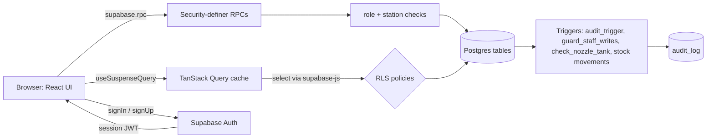
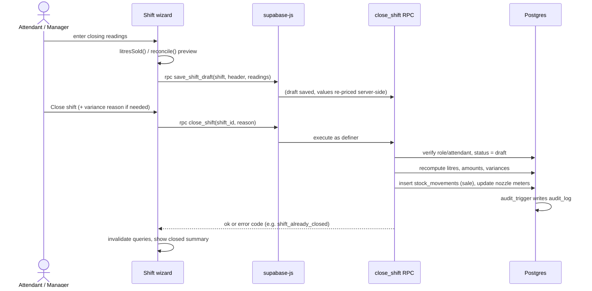

# Architecture

PumpHisab is a TanStack Start v1 app (React 19 + Vite 7) built for an edge/Worker runtime. The backend is Supabase (Postgres + Auth), provided through Lovable Cloud. The app has no custom HTTP API. The browser talks to Supabase directly:
- **Reads** use the Supabase JS client. Row Level Security (RLS) limits each read to the user's stations.
- **Writes** to financial or operational records go through **security-definer Postgres functions (RPCs)**. These functions validate the input, recompute the totals and write audit rows.

No `createServerFn` or `src/routes/api` handlers are used yet. `src/integrations/supabase/` (generated) also contains a server admin client and auth middleware, but the app does not currently import them.

## Folder layout
```text
src/
  routes/                      file-based routes (TanStack Router)
    __root.tsx                 html shell, providers, Toaster
    index.tsx                  public landing page
    auth.tsx, forgot-password.tsx, reset-password.tsx
    _authenticated/route.tsx   redirects to /auth when signed out
    _authenticated/onboarding.tsx   create first station
    _authenticated/_app/route.tsx   sidebar shell; redirects to /onboarding without a station
    _authenticated/_app/*.tsx  dashboard, setup, shifts, fuel-stock, customers,
                               suppliers, expenses, reports, history, settings (+ detail routes)
  components/
    ui/                        shadcn/ui primitives
    common/                    page headers, empty/loading states, confirm dialog, language select
    setup/ inventory/ finance/ settings/   module components and dialogs
    app-sidebar.tsx            permission-filtered navigation
  lib/
    setup.ts shifts.ts inventory.ts finance.ts reports.ts   queryOptions + pure calculations
    permissions.ts             UI role matrix (`can()`)
    station.ts                 current station + role query
    schemas.ts                 zod form schemas
    i18n/                      dictionaries + provider
  integrations/supabase/       generated client and types (do not edit)
drizzle/migrations/            SQL migrations (schema, RLS, RPCs, triggers)
```

## State and data access
- **Server state:** TanStack Query. Each module exports `queryOptions` factories that take a station id, for example `customersQuery(stationId)` in `src/lib/finance.ts`. After a mutation the app invalidates key groups such as `FINANCE_KEYS` and `INVENTORY_KEYS`.
- **Calculations** are pure functions (for example `litresSold`, `reconcile`, `breakdown`, `customerBalance`) that the UI uses for live previews. The SQL RPCs repeat the same formulas and are the authoritative result. See [BUSINESS-LOGIC.md](BUSINESS-LOGIC.md).
- **Local UI state:** React state and react-hook-form with zod (`src/lib/schemas.ts`).
- **Language:** React context in `src/lib/i18n/index.tsx`. See [I18N.md](I18N.md).

## Auth and authorization
1. Users sign up and sign in with Supabase email/password. Email confirmation is required.
2. `_authenticated/route.tsx` gates every signed-in page. `_app/route.tsx` loads the user's station and role (`src/lib/station.ts`).
3. The UI hides actions with `can(role, permission)` (`src/lib/permissions.ts`). This is for convenience only.
4. The real boundary is in Postgres: RLS with `is_station_member` / `has_station_role`, role checks inside each RPC, and the `guard_staff_writes` trigger. Details: [SECURITY.md](SECURITY.md).



## Example: closing a shift


## Module relationships
```text
products -> tanks -> nozzles -> shift_readings -> shifts
fuel_prices --(snapshot)--> shift_readings
shifts --close--> stock_movements(sale)  <- fuel_deliveries <- suppliers -> supplier_payments
tank_dips -> stock_adjustments --approve--> stock_movements(adjustment)
customers -> customer_transactions (credit_sale may link to a shift)
expenses / shift_cash_movements -> shift drawer reconciliation
everything -> audit_log (server-written)
```
