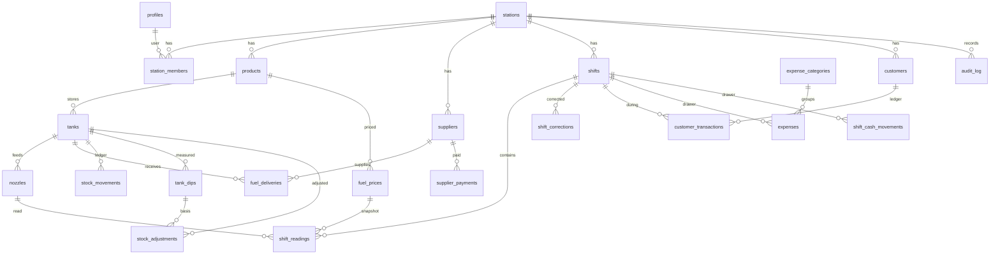

# Database

Postgres via Supabase (Lovable Cloud). The schema is defined by SQL migrations in [`drizzle/migrations`](../drizzle/migrations). The generated TypeScript types are in `src/integrations/supabase/types.ts`. Every table uses a `uuid` primary key `id`.

## Migrations
| File | Contents |
|---|---|
| `0000_foundation.sql` | `profiles`, `stations`, `station_members`, `station_role` enum, membership helpers, signup trigger, `create_station_with_owner` |
| `0001_station_setup.sql` | `products`, `tanks`, `tank_stock_corrections`, `nozzles`, `fuel_prices`, `suppliers`, nozzle/tank trigger |
| `0002_tighten_function_grants.sql` | Restricts EXECUTE on helper functions |
| `0003_shift_management.sql` | `shifts`, `shift_readings`, `shift_corrections`, shift RPCs |
| `0004_fuel_inventory.sql` | `fuel_deliveries`, `stock_movements`, `tank_dips`, `stock_adjustments`, `stations.dip_variance_litres`, backfill |
| `0005_adjustment_at_dip_time.sql` | Dates approved adjustments at the dip time |
| `0006_finance_udhaar_payables_expenses_cash.sql` | `customers`, `customer_transactions`, `supplier_payments`, `expense_categories`, `expenses`, `shift_cash_movements`, drawer fields on `shifts` |
| `0007_roles_audit_staff.sql` | `audit_log`, audit triggers, `guard_staff_writes`, staff management RPCs |

## Tables
| Table | Purpose | Key columns |
|---|---|---|
| profiles | One row per auth user | `id` → auth.users, `full_name`, `preferred_language` |
| stations | A petrol station | `name`, `city`, `contact_phone`, `preferred_language`, `dip_variance_litres` |
| station_members | User ↔ station + role | `station_id`, `user_id`, `role` (`owner`/`manager`/`staff`) |
| products | Fuel products | `name`, `code`, `unit` (`litre`/`kg`/`piece`), `is_fuel`, `is_active` |
| tanks | Storage tanks | `product_id`, `capacity_litres`, `opening_stock_litres`, `low_stock_litres` |
| nozzles | Dispenser nozzles | `number`, `product_id`, `tank_id`, `meter_reading` |
| fuel_prices | Insert-only price history | `product_id`, `price_per_litre`, `effective_at` |
| suppliers | Fuel suppliers | `business_name`, `opening_payable` |
| tank_stock_corrections | Legacy stock corrections (superseded by adjustments) | `old_litres`, `new_litres`, `reason` |
| shifts | Shift header and totals | `status` (`draft`/`closed`), `price_at`, collection columns, `total_sales`, `difference`, `drawer_expected`, `cash_variance`, `variance_reason` |
| shift_readings | Per-nozzle readings | `opening_reading`, `closing_reading`, `test_litres`, `rollover_max`, `price_id`, `price_per_litre`, `litres_sold`, `amount` |
| shift_corrections | Audit of closed-shift edits | `field`, `old_value`, `new_value`, `reason` |
| fuel_deliveries | Receipts (also the supplier invoices) | `challan_no`, `litres`, `rate_per_litre`, `calculated_amount`, `invoice_amount`, reversal columns |
| stock_movements | Stock ledger | `kind` (`opening`,`delivery`,`delivery_reversal`,`sale`,`sale_correction`,`adjustment`), signed `litres`, `source_id` |
| tank_dips | Physical measurements | `measured_at`, `measured_litres` |
| stock_adjustments | Requested corrections | `litres`, `status` (`pending`/`approved`/`rejected`), `dip_id` |
| customers | Udhaar customers | `vehicles[]`, `credit_limit`, `opening_balance` |
| customer_transactions | Credit sales and payments | `kind` (`credit_sale`/`payment`), `amount`, `method`, `over_limit`, `client_key`, reversal columns |
| supplier_payments | Payments to suppliers | `amount`, `method` (`bank`,`cash`,`cheque`,`wallet`,`other`), `client_key` |
| expense_categories | Per-station categories | `name` (unique per station, case-insensitive) |
| expenses | Expenses | `method` (`drawer`/`bank`/`other`; drawer ⇔ `shift_id` set), `client_key` |
| shift_cash_movements | Cash put into or taken out of the drawer | `kind` (`cash_in`/`cash_out`), `reason` |
| audit_log | Server-written history | `action`, `entity`, `entity_id`, `reason`, `details` jsonb |

Every business table has `station_id` → `stations.id`. Several composite foreign keys (for example `nozzles(station_id, tank_id)`) stop rows from referencing another station's records.

## Notable indexes and constraints
- `shift_readings_one_open_per_nozzle`: a nozzle can be in only one draft shift at a time.
- `fuel_deliveries_unique_challan`: unique on (station, supplier, lower(trim(challan_no))).
- `expense_categories_name_uq`, `fuel_prices_lookup`, `stock_movements_tank`, `tank_dips_tank`, `shifts_station_date`, `audit_log_station_time`.
- `client_key` columns are unique, which makes postings idempotent.
- Stock movements are unique per (kind, source_id).

## RLS summary
RLS is enabled on every table.
- **SELECT:** `is_station_member(station_id, auth.uid())`. Audit history is limited to owner and manager.
- **Setup tables** (products, tanks, nozzles, suppliers, customers, categories): INSERT/UPDATE for owner and manager, no DELETE. Tank stock columns are protected by `guard_tank_update`.
- **fuel_prices:** INSERT for owner only. No UPDATE or DELETE.
- **Transactional tables** (shifts, readings, deliveries, movements, dips, adjustments, finance, audit): no direct INSERT, UPDATE or DELETE. Changes go only through RPCs.
- **station_members:** read only. Changes go through `create_station_with_owner`, `add_station_member`, `set_member_role` and `remove_station_member`.

## ER diagram

## Data handling
The repository contains no customer data or credentials. Development test stations exist in the connected backend and are not exported.
